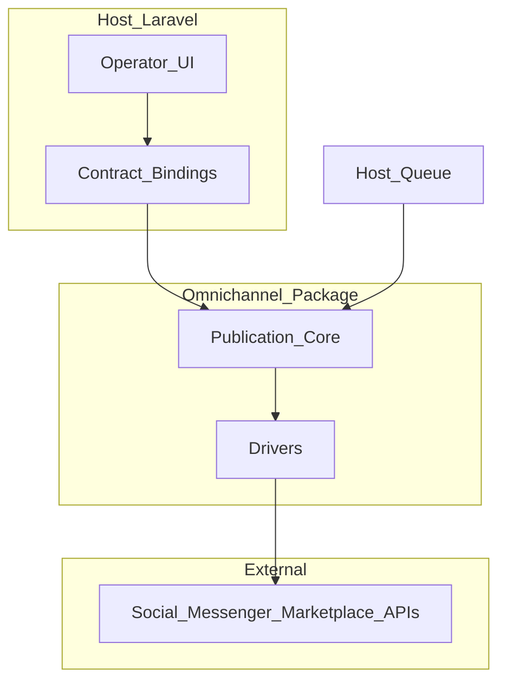

# ARCHITECTURE — karnoweb/omnichannel

| | |
|---|---|
| نسخه سند | 0.1-draft |
| نسخه سورس مبنا | 13.3.0 |
| commit | `2e6593a` |
| PRD | [PRD.md](PRD.md) v0.1-draft |
| تاریخ | 2026-11-21 |
| وضعیت | پیش‌نویس معماری — **پیاده‌سازی To-Be نشده** |

ضمائم: [docs/phase-04/step-05/](docs/phase-04/step-05/README.md)

---

## ۱. خلاصه

پکیج Laravel **چندکاناله بدون UI**: درایورهای خارجی، Publication/Batch، رسانه قراردادی، catalog sync اختیاری. معماری As-Is در عمل برای هسته انتشار **پایدار** است؛ To-Be = تثبیت + تکمیل شکاف‌های مستندشده (rate IG، Graph، ارتقا DB، host reference) بدون بازنویسی کل.

## ۲. اهداف معماری

- استقلال میزبان (P-01)، مرز قراردادی
- Publication مستقل + Batch هماهنگ (P-03)
- امنیت: branch، SSRF، redaction
- توسعه‌پذیری درایور
- سازگاری نسخه مصرف‌کننده

**غیرهدف:** microservice، event sourcing، UI میزبان.

## ۳. زمینه (Context)

## ۴. As-Is در یک نگاه

| حوزه | وضعیت | مرجع |
|---|---|---|
| درایور ۹ کانال | پیاده | `src/Channels/` |
| State machine | پیاده | PUBLICATION-LIFECYCLE |
| Media omc-asset | پیاده | MEDIA-ARCHITECTURE |
| Catalog sync | off default | CATALOG-ARCHITECTURE |
| Rate limit | per channel | HTTP-QUEUE |
| Host FK | soft ref | DATA-ARCHITECTURE |

جزئیات: [CURRENT-ARCHITECTURE.md](docs/phase-04/step-05/CURRENT-ARCHITECTURE.md).

## ۵. To-Be (پیشنهاد)

| تغییر | اولویت | وضعیت |
|---|---|---|
| حفظ ساختار ماژول | — | تثبیت |
| IG rate / Graph | P1 | مشروط DEC-001,006 |
| Upgrade test 13.3 | P1 | FR-038 |
| Batch retry policy | P2 | طراحی |
| Reference registrar | P3 | میزبان |
| Webhook | — | خارج دامنه |

جزئیات: [TARGET-MODULES.md](docs/phase-04/step-05/TARGET-MODULES.md).

## ۶. ماژول‌ها

Publication، Media، Catalog، Drivers، Http/Queue، Security — نمودار در TARGET-MODULES.

## ۷. قراردادها و میزبان

[PUBLIC-CONTRACTS-AND-HOST.md](docs/phase-04/step-05/PUBLIC-CONTRACTS-AND-HOST.md)

## ۸. درایورها

[DRIVER-ARCHITECTURE.md](docs/phase-04/step-05/DRIVER-ARCHITECTURE.md) + [providers/](docs/providers/README.md)

## ۹. چرخه انتشار

[PUBLICATION-LIFECYCLE.md](docs/phase-04/step-05/PUBLICATION-LIFECYCLE.md)

## ۱۰. HTTP، صف، بازیابی

[HTTP-QUEUE-AND-RECOVERY.md](docs/phase-04/step-05/HTTP-QUEUE-AND-RECOVERY.md)

## ۱۱. امنیت و رسانه

[SECURITY-ARCHITECTURE.md](docs/phase-04/step-05/SECURITY-ARCHITECTURE.md) | [MEDIA-ARCHITECTURE.md](docs/phase-04/step-05/MEDIA-ARCHITECTURE.md)

## ۱۲. کاتالوگ

[CATALOG-ARCHITECTURE.md](docs/phase-04/step-05/CATALOG-ARCHITECTURE.md)

## ۱۳. داده و مهاجرت

[DATA-ARCHITECTURE.md](docs/phase-04/step-05/DATA-ARCHITECTURE.md) | [MIGRATION-AND-COMPATIBILITY.md](docs/phase-04/step-05/MIGRATION-AND-COMPATIBILITY.md)

## ۱۴. عملیات

[OPERATIONS-AND-OBSERVABILITY.md](docs/phase-04/step-05/OPERATIONS-AND-OBSERVABILITY.md)

## ۱۵. تصمیم‌ها (ADR)

[ARCHITECTURE-DECISIONS.md](docs/phase-04/step-05/ARCHITECTURE-DECISIONS.md) — تصمیم‌های باز: DEC-001,002,005,006,007,008.

## ۱۶. ردیابی و اعتبارسنجی

[ARCHITECTURE-TRACEABILITY.md](docs/phase-04/step-05/ARCHITECTURE-TRACEABILITY.md) | [VALIDATION-PLAN.md](docs/phase-04/step-05/VALIDATION-PLAN.md)

## ۱۷. ادامه فاز ۴

[NEXT-STEPS.md](docs/phase-04/step-05/NEXT-STEPS.md) → ۴.۶ CHANGELOG، ۴.۷ ROADMAP، ۴.۸ CONTRIBUTING.

## ۱۸. واژه‌نامه

Publication، Batch، ChannelDriver، Connection، Catalog sync — همان PRD §15.