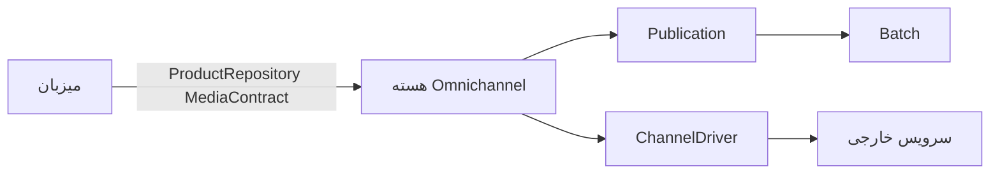

# PRD — karnoweb/omnichannel

**نسخه سند:** 0.1-draft | **نسخه سورس مبنا:** 13.3.0 | **تاریخ:** 2026-11-21  
**وضعیت:** پیش‌نویس آماده بازبینی مالک محصول — **مصوب نشده**

> سند اصلی خلاصه است. جزئیات: [docs/phase-04/step-04/](docs/phase-04/step-04/).

---

## ۱. خلاصه اجرایی

`karnoweb/omnichannel` کتابخانه Laravel برای انتشار و هماهنگی چند کانال (اجتماعی، پیام‌رسان، بازارگاه/کاتالوگ) **بدون UI میزبان**. امروز: ۹ درایور، Publication/Batch، رسانه قراردادی، catalog sync اختیاری (خاموش پیش‌فرض)، 102 تست محلی SQLite. مقصد: محصول مستقل قابل نگهداری با مستندات فارسی کامل، سیاست شفاف per کانال، و آمادگی تولید **مشروط** تصمیم‌های باز و live validation.

## ۲. مسئله و ارزش

| مسئله | شاهد |
|---|---|
| پراکندگی API و قابلیت‌ها | step-02 providers |
| اختلاف اعلام vs اجرا | step-03 GAP |
| نیاز انتشار گروهی مستقل | phase-03 DECISIONS |
| مرز commerce میزبان | HOST-INTEGRATION |

**ارزش:** یک لایه orchestration با قرارداد واحد برای توسعه‌دهنده میزبان.

## ۳. مخاطبان

توسعه‌دهنده پکیج/میزبان، DevOps، اپراتور (غیرمستقیم). جزئیات: [PRODUCT-SCOPE.md](docs/phase-04/step-04/PRODUCT-SCOPE.md).

## ۴. اصول P-01..P-06

همه با شاهد فاز ۳ حفظ می‌شوند مگر تصمیم جدید مالک. جزئیات: PRODUCT-SCOPE.

## ۵. دامنه

- **فعلی:** انتشار، batch، زمان‌بندی، رسانه، درایورها، taxonomy جزئی، sync اسکلت.
- **مقصد پیشنهادی:** تکمیل شکاف‌های P1، DOC-001..004، live حداقلی کانال‌های A.
- **غیرهدف:** UI میزبان، inbox، webhook (فعلاً)، CRM.

جدول کامل: PRODUCT-SCOPE.md.

## ۶. مدل مفاهیم

- **Connection:** حساب پیکربندی‌شده
- **Publication:** واحد وضعیت (P-03)
- **Batch:** هماهنگ‌کننده چند Publication
- **Driver:** تطبیق با سرویس خارجی

## ۷. مرز مسئولیت

| موضوع | پکیج | میزبان |
|---|---|---|
| قیمت/موجودی مرجع | consume | **مالک** |
| UI اپراتور | — | **مالک** |
| صف/infra | jobs | اجرا |
| توکن | استفاده امن | ورود |

## ۸. نیازمندی‌ها (خلاصه)

| نوع | تعداد | فایل |
|---|---|---|
| FR | 44 | [FUNCTIONAL-REQUIREMENTS.md](docs/phase-04/step-04/FUNCTIONAL-REQUIREMENTS.md) |
| NFR | 18 | [NON-FUNCTIONAL-REQUIREMENTS.md](docs/phase-04/step-04/NON-FUNCTIONAL-REQUIREMENTS.md) |
| DOC | 4 | [DOCUMENTATION-REQUIREMENTS.md](docs/phase-04/step-04/DOCUMENTATION-REQUIREMENTS.md) |
| FLOW | 10 | [USER-FLOWS.md](docs/phase-04/step-04/USER-FLOWS.md) |

## ۹. سیاست سرویس‌دهندگان

۸ سرویس + Demo؛ سطوح A/B/C/D. جزئیات: [PROVIDER-SUPPORT-POLICY.md](docs/phase-04/step-04/PROVIDER-SUPPORT-POLICY.md).

## ۱۰. موفقیت و آمادگی

معیارها MET-001..008. آمادگی تولید **فعلی: خیر** (تصمیم‌های باز، live، میزبان). [SUCCESS-AND-READINESS.md](docs/phase-04/step-04/SUCCESS-AND-READINESS.md).

## ۱۱. الزامات مستندسازی مالک (DOC-001..004)

| DOC | عنوان | وضعیت |
|---|---|---|
| DOC-001 | CHANGELOG | جزئی → ۴.۶ |
| DOC-002 | providers | تکمیل ۴.۲ |
| DOC-003 | فارسی فنی | در تکمیل |
| DOC-004 | نقشه راه | → ۴.۷ |

## ۱۲. تصمیم‌های باز

DEC-001..008 در [PRODUCT-DECISIONS.md](docs/phase-04/step-04/PRODUCT-DECISIONS.md). هیچ‌کدام مصوب نشده.

## ۱۳. ریسک و ردیابی

[RISKS-AND-ASSUMPTIONS.md](docs/phase-04/step-04/RISKS-AND-ASSUMPTIONS.md) | [REQUIREMENTS-TRACEABILITY.md](docs/phase-04/step-04/REQUIREMENTS-TRACEABILITY.md)

## ۱۴. مراحل بعد

[NEXT-STEPS.md](docs/phase-04/step-04/NEXT-STEPS.md) — ورودی ۴.۵ معماری، ۴.۶ CHANGELOG، ۴.۷ ROADMAP، ۴.۸ CONTRIBUTING.

## ۱۵. واژه‌نامه

| اصطلاح | معنی |
|---|---|
| Publication | واحد انتشار با وضعیت مستقل |
| Batch | گروه انتشار هماهنگ‌شده |
| ChannelDriver | پیاده‌سازی کانال خارجی |
| Connection | پیکربندی اتصال به سرویس |
| catalog sync | همگام‌سازی اختیاری قیمت/موجودی |
| میزبان | اپلیکیشن Laravel مصرف‌کننده پکیج |
| capabilities() | اعلام پشتیبانی درایور |

---

ضمائم مرحله: [step-04/README.md](docs/phase-04/step-04/README.md) | ممیزی: [step-03](docs/phase-04/step-03/README.md)