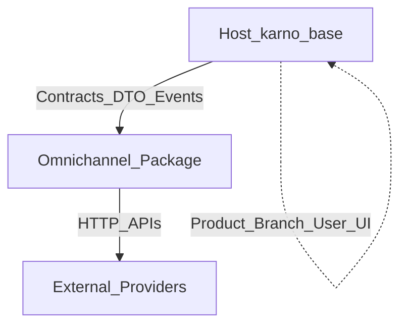
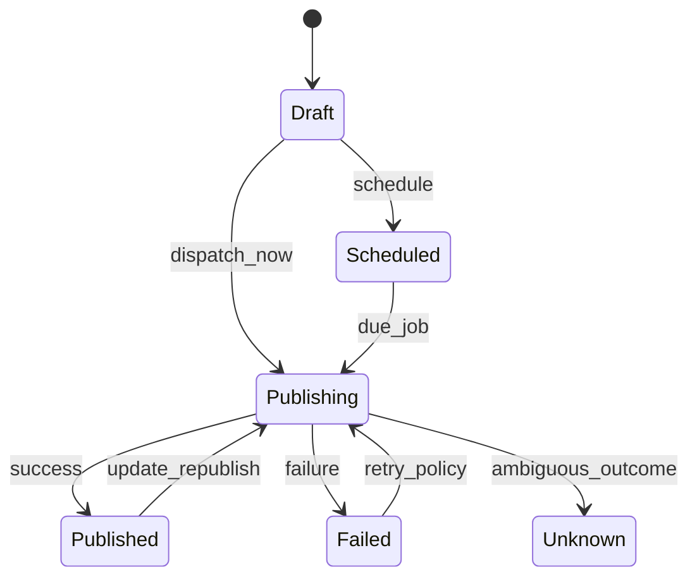

# معماری فعلی — 13.3.0

## مرز پکیج و میزبان

میزبان: `ProductRepository`, `BranchContextResolverContract`, `ActorContextResolverContract`, رسانه/آداپتور اختیاری، listener قیمت/موجودی برای catalog sync.

## ورود و DI

| نقطه | مسیر |
|---|---|
| ServiceProvider | `src/OmnichannelServiceProvider.php` |
| Facade | `Karnoweb\Omnichannel\Facades\Omnichannel` |
| سرویس ریشه | `src/Omnichannel.php` — drivers, publishing, logger, context |
| درایورها | `config/omnichannel.php` → `ChannelManager` |

## جریان انتشار (خلاصه)

- ایجاد: `PublishingService` → `PublicationCreationService` (Product/FreeForm)
- ارسال: `PublishPublicationJob` → `ChannelDriver`
- Batch: `PublicationBatchService` → چند `Publication` مستقل
- Catalog: `CatalogSyncTriggerContract` → `CatalogSyncDispatcher` (اگر فعال)

## جداول (پیش‌فرض پیشوند `omc_`)

| کلید config | جدول | فاز |
|---|---|---|
| channels, connections, publications, publication_logs | اصلی | ۱ |
| — | publication media/batches/taxonomy/catalog | ۳ (`2026_11_21_000002`–`000005`) |

ستون‌های جدید انتشار: `source_type`, `source_reference_*`, `source_title`; `product_id` nullable (migration `000001`).

## قراردادهای میزبان (نمونه)

`ProductRepository`, `PublicationSourceResolverContract`, `InternalCategoryResolverContract`, `CatalogSyncTriggerContract`, `PublicationMediaStorageContract`, `PublicationMediaUrlResolverContract`.

جزئیات API عمومی: [PUBLIC-API-INVENTORY.md](PUBLIC-API-INVENTORY.md).