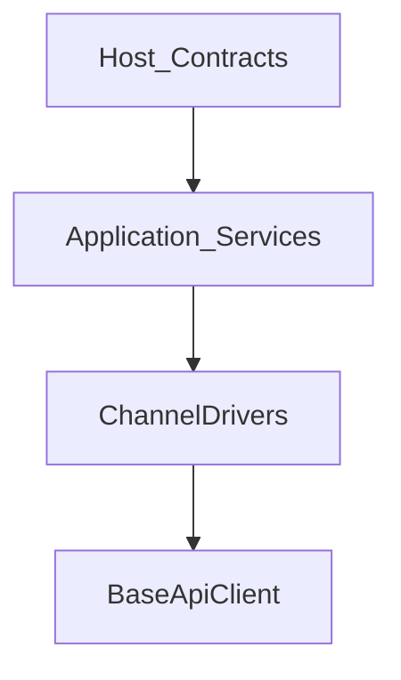

# CURRENT-ARCHITECTURE (As-Is)

مبنا: [step-01/CURRENT-ARCHITECTURE.md](../step-01/CURRENT-ARCHITECTURE.md) + بررسی سورس `2e6593a`.

## لایه‌ها

| لایه | مسئولیت | کلاس‌های شاخص |
|---|---|---|
| ورود | DI، config | `OmnichannelServiceProvider`, `Omnichannel` |
| Application | اورکستراسیون | `PublishingService`, `PublicationCreationService`, `PublicationBatchService` |
| Domain contracts | مرز میزبان | `ChannelDriver`, `ProductRepository`, media contracts |
| Infrastructure | HTTP، صف | `BaseApiClient`, jobs در `src/Jobs/` |
| Channels | adapter سرویس | `src/Channels/*` |

## وابستگی (جهت مجاز)

میزبان → پکیج از طریق قرارداد؛ درایور → HTTP؛ **بدون** import مدل میزبان (`tests/Architecture/NoHostDependencyTest`).

## جریان انتشار

`CreatePublicationData` → `PublicationCreationService` → `Publication` (DB) → `PublishPublicationJob` → `PublishingService::publish` → `ChannelDriver` → `PublishResult` → state machine.

شواهد: `PublicationStateMachineTest`, `PUBLICATION-LIFECYCLE.md`.

## یافته‌های مرتبط (بدون تکرار ممیزی)

| شناسه | اثر معماری |
|---|---|
| OMC-AUD-006 | Reference source بدون registrar |
| OMC-AUD-010 | Catalog sync off by default |
| P43-GAP-002 | Rate limit IG vs Meta |
| P43-GAP-007 | تست ارتقا 13.3 ناقص |

## حفظ در To-Be

Publication واحد وضعیت، Batch هماهنگ‌کننده، قرارداد درایور، `BranchScope`, rate limiter، SSRF resolver — هم‌راستا PRD P-01..P-06.