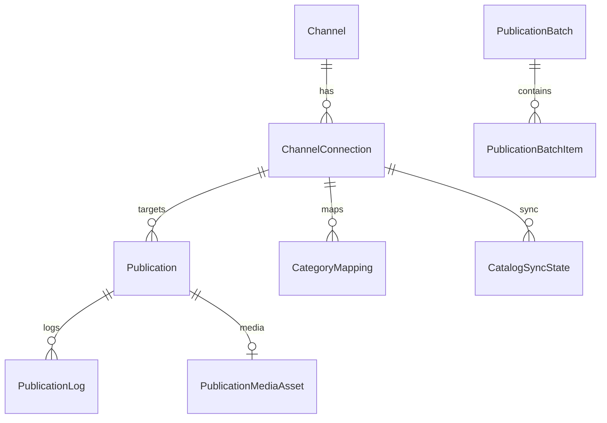

# DATA-ARCHITECTURE

## موجودیت‌های اصلی

مدل‌ها: `src/Models/*` — table names via `OmnichannelTables`.

## یکتایی و تاریخچه

- publications: history preserved (migration فاز ۲)
- idempotency keys

## تراکنش

Service-level DB transactions در creation/publish — جزئیات در کد `PublishingService`/`PublicationCreationService` (As-Is).

## To-Be

- تست ارتقا 13.2→13.3 کامل (FR-038)
- CI MySQL/PG (NFR-010) — بدون تغییر schema پیشنهادی در این مرحله