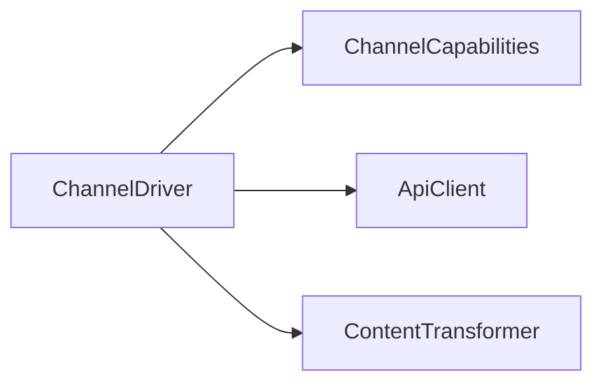

# DRIVER-ARCHITECTURE

## الگوی مشترک

- پایه پیام‌رسان: `BotApiDriver` → Telegram، Bale
- کاتالوگ: `WhatsAppDriver`, `BasalamDriver`
- اجتماعی: `InstagramDriver`
- C-tier: Rubika, Gap, Eitaa — همان الگو، شواهد رسمی ضعیف

## تصمیم per سرویس (خلاصه)

| درایور | کلاینت | To-Be |
|---|---|---|
| instagram | `InstagramApiClient` | حفظ؛ DEC-006 نسخه Graph |
| telegram | `BotApiClient` | مرجع الگو |
| whatsapp | `WhatsAppCatalogClient` | catalog only؛ batch + poll job |
| basalam | `BasalamApiClient` | OAuth؛ taxonomy interface |
| bale | `BotApiClient` | **مشروط** parity با Bale API P42-DIFF-005 |
| rubika/gap/eitaa | اختصاصی | best-effort؛ بدون بازطراحی تا DEC |

## قابلیت

`capabilities()` منبع حقیقت مصرف‌کننده — `UnsupportedCapabilityException` قبل از HTTP.

## توسعه درایور جدید (To-Be استاندارد ۴.۸)

1. `ChannelDriver` + `capabilities()`
2. `*ApiClient` extends `BaseApiClient` (rate limit middleware)
3. transformers جدا
4. `DriverContractTest` + feature mocks
5. صفحه در `docs/providers/`