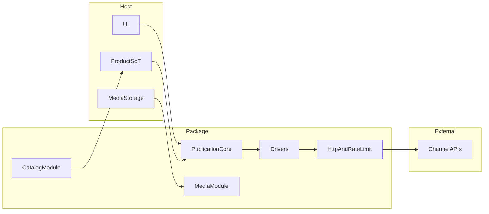

# TARGET-MODULES (To-Be)

**وضعیت:** پیشنهاد معماری — پیاده‌سازی نشده مگر خلاف آن ذکر شود.

## مقایسه ماژول

| ماژول | As-Is | To-Be پیشنهادی | دلیل |
|---|---|---|---|
| Driver registry | `ChannelManager` | **حفظ** | P-01 |
| Publication core | services موجود | **حفظ** + مستند state | P-03 |
| Batch | `PublicationBatchService` | **حفظ**؛ تقویت retry سیاست | FR-015 مشروط |
| Media | `PublicationMediaService` | **حفظ** `omc-asset` contract | phase-03 |
| Taxonomy | `MarketplaceTaxonomyService` | **حفظ**؛ live sync اختیاری | OMC-AUD-008 |
| Catalog sync | `CatalogSyncService` | **حفظ** off default | P-05 |
| WA reconcile | service موجود | **حفظ** اختیاری | FR-034 |
| Reference source | registry خالی | **توسعه مشروط** registrar میزبان | OMC-AUD-006 |
| Rate limit | per-channel config | **هم‌راستاسازی IG** مشروط DEC-001 | P43-GAP-002 |
| Webhook ingress | ندارد | **خارج دامنه** تا DEC-008 | FR-040 |

## مرز ماژول مقصد

## قوانین وابستگی To-Be

1. `Channels/*` نباید به `Models` میزبان وابسته شود.
2. Commerce sync فقط از طریق `CatalogSyncPolicy` و trigger میزبان.
3. هر درایور جدید: `ChannelDriver` + `ChannelCapabilities` + error mapper.