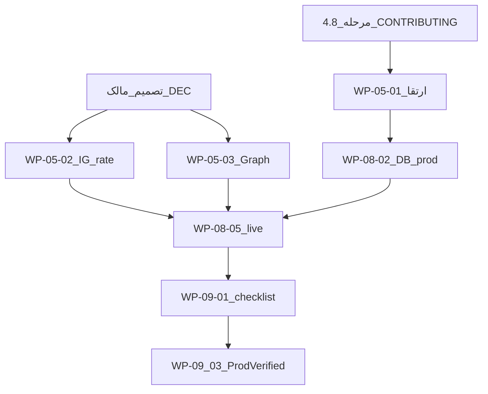

# DEPENDENCY-MAP

## جدول وابستگی (نمونه بحرانی)

| بسته | پیش‌نیاز | نوع | سخت؟ |
|------|-----------|-----|------|
| WP-05-02 | DEC-001 | تصمیم | بله |
| WP-05-03 | DEC-006 | تصمیم | بله |
| WP-05-08 | DEC-005 | تصمیم | نرم |
| WP-06-02 | DEC-003, WP-07-01 اختیاری | محصولی/فنی | نرم |
| WP-08-05 | مجوز live، DECهای کانال | بیرونی | بله |
| WP-09-01 | WP-08-xx عمده | فاز | بله |
| WP-09-02 | WP-09-01, REL-DEC-002 | تصمیم | بله |
| WP-DEC-002 | DEC-002 | تصمیم | — |

## کارهای مستقل پس از ۴.۸

- WP-DOC-001..003 (همراه هر PR)
- WP-07-03 (مستند)
- WP-05-01 (بدون DEC — فقط تست)
- WP-08-01 (CI — نیاز ۴.۸)

## مسیر بحرانی (پیش‌نیاز پایان پروژه)

`DEC مصوب` → `WP-05-01` → `WP-08-02` → `WP-05-02/03` → `WP-08-05` → `WP-09-01` → `WP-09-03`

## نمودار

## چرخه پیشنهادی

DEC-001 ↔ WP-05-02 ↔ DOC IG — حل: تصمیم یک‌بار، سپس doc+config+test در یک بسته.